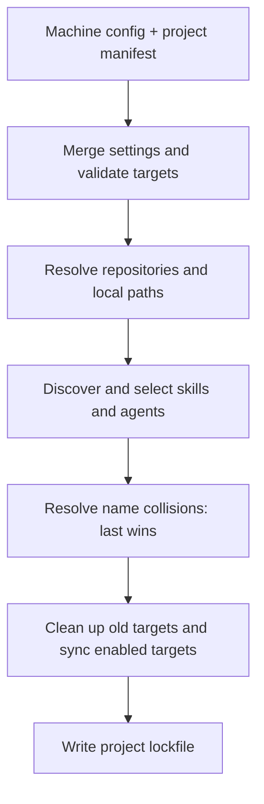

# Architecture

[README](./README.md) | [Configuration](./docs/configuration.md) | [Contributing](./CONTRIBUTING.md)

`agents-config` separates what a project requests from how each coding tool
receives it. Configuration supplies dependencies and targets; target handlers
own installation and cleanup.

## Install Pipeline

All enabled targets are validated before dependencies are fetched or installed.
Dependency resolution failures abort before installed content is changed, so
an unavailable repository cannot accidentally turn into a request to prune it.
This is not a transaction across handlers: a later installation failure does
not imply that earlier filesystem changes are rolled back.

Repository dependencies are cloned or updated in the configured cache. Local
`path` dependencies are read live without a `ref`; with a `ref`, a resolved
commit is extracted using `git archive` into the snapshot cache. Archive
exclusions in `.gitattributes` apply.

Discovery reads `skills/<name>/SKILL.md` and agents under `agents/`. Dependency
selections filter the results. When multiple dependencies provide the same
name, the later dependency in merged order wins; the replacement is reported
and only the winner is installed.

## Configuration Composition

Machine `config.yaml` and project `agents.yaml` share one schema. Scalars
replace, target settings merge by key, and dependency entries with the same
normalized repository or path replace in place. Distinct dependencies append.
This makes dependency order significant for same-name collisions.

Targets execute in first-appearance order, starting with machine configuration.
Overriding a target's settings does not move it. A different explicit `handler`
starts that target's settings fresh; absent or `null` settings use the handler's
defaults. There is no implicit target.

## Ownership and Cleanup

One project-level `agents-lock.json` records the winning sources and each
target's handler and opaque handler-owned state. Built-in handler state records
concrete installed paths relative to the project directory. Ownership is per
item, not per destination directory.

- Only recorded paths are candidates for overwrite or removal. Unmanaged
  content is left alone and conflicts are reported.
- Desired lock-owned copies that are missing or modified are restored.
- Stale modified copies, or links replaced by real files, are warned about
  and preserved with their ownership record.
- Copy change detection uses SHA-256 over sorted paths and file contents,
  not file size or modification time.
- Unreadable or old-format locks abort rather than silently losing ownership.

Disabled, removed, or handler-switched targets are first passed to their
original handler with an empty request and `enabled: false`. Cleanup runs
before current installs. If the original handler is unavailable, the run
aborts instead of forgetting installed content.

The lock records ownership and resolved information; repository dependencies
using moving refs are fetched again on installation. Use an explicit commit
ref when the repository content must remain pinned.

## Target Handlers

Each target resolves a `handler/<name>` definition, unless its settings name
another handler. Handlers receive the requested items, merged target settings,
and their previous lock record. Handler defaults are not injected into the
configuration merge.

Built-ins `interop`, `claude`, `opencode`, and `codex` share a flat copy/link
routine but own their destination defaults and unsupported kinds. Codex skips
agents until Markdown-to-TOML conversion exists. Agents for other tools are
installed without conversion.

The `*-interop` handlers resolve and extend the corresponding plain handler
rather than duplicating it. They inspect shared directories at run time, so
`interop` must run before them to expose its installs. Native kinds, such as
OpenCode and Codex skills, need no mirror. Other kinds are mirrored per item
or installed normally according to configuration. See
[targets and interop](./docs/configuration.md#targets-and-interop).

Links inside the project are relative so the project can be moved. Links to
machine-local cached dependencies are absolute.

## Application Composition

`src/index.ts` is the CLI host: it adapts the current directory, environment,
and flags, calls `bootstrapApp()`, and dispatches commands through the container.

`src/app.ts` composes keyed lazy services in deterministic order: platform,
config, repository cache, discovery, manifest, lockfile, hashing, installation,
orchestration, CLI commands, and final host overrides. Targets are configuration
data, not container keys. Handlers are code and therefore container definitions.

A provider passed to `bootstrapApp({ modules })` can add a handler or override
a built-in service. Overriding a plain harness handler also affects its interop
variant. Module loading is currently programmatic; the YAML CLI configuration
does not load JS/TS modules.

Ordinary same-layer internal calls remain plain imports where a container
boundary would add indirection without a meaningful extension point.

## DI Provenance

`src/di/` vendors the unpublished `@uny/di` implementation from
[`UN1Q-com/uny`](https://github.com/UN1Q-com/uny). It is copied into this
repository, not linked at runtime. Local differences cover TypeScript import
adaptation, strict-type compatibility fixes, and provenance comments. Upstream
changes must currently be synchronized manually.
